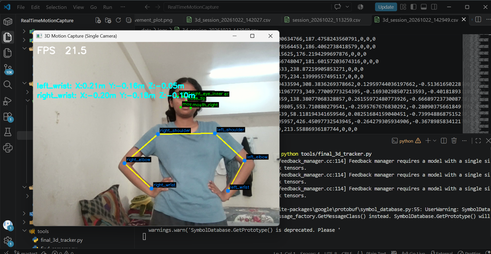
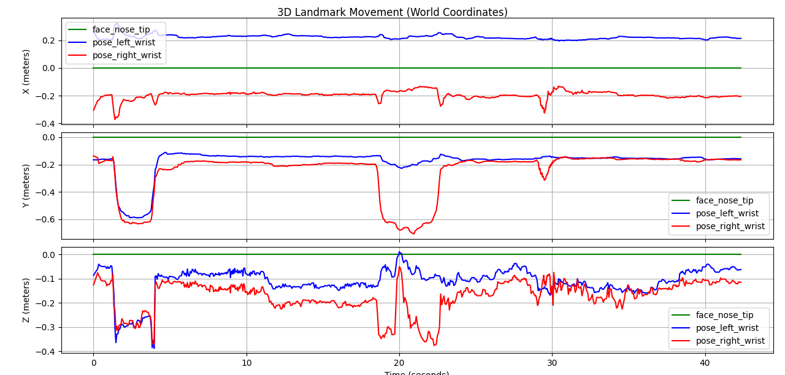

# Real-Time 3D Motion Capture using Computer Vision


## 📌 Project Overview
This project is a markerless, real-time 3D motion capture system. Using only a standard webcam, it detects facial landmarks and upper-body skeletal joints (shoulders, elbows, wrists) and estimates their 3D coordinates (X, Y, Z) in metric space.

Unlike traditional motion capture systems that require expensive infrared cameras or wearable sensor suits, this project uses Google's **MediaPipe** AI models to achieve 3D tracking from a single monocular camera view, running smoothly at **20-30 FPS** on a standard CPU.

## 📸 Demo & Results

**Live 3D Tracking Overlay:**


**3D Coordinate Analysis:**
The system logs the X, Y, and Z coordinates in real-time and plots the movement trajectory. The graph below clearly demonstrates depth (Z-axis) estimation as the user moves their arms.


## ✨ Key Features
*   **Markerless & Wearable-Free:** Just sit in front of a webcam; no suits or reflective markers required.
*   **True 3D Estimation:** Extracts 2D pixels and translates them into 3D world coordinates (meters) using MediaPipe's World Landmarks.
*   **Real-Time Skeletal Overlay:** Draws a live tracking overlay on the video feed using OpenCV.
*   **Data Logging & Analytics:** Automatically logs thousands of frames of X, Y, Z coordinates to CSV files.
*   **Data Visualization:** Includes a Matplotlib script to generate trajectory graphs of hand and face movement over time for analysis.

## 🛠️ Technology Stack
*   **Python 3.10** - Core programming language.
*   **OpenCV (`opencv-python`)** - Video capture, image processing, and drawing overlays.
*   **MediaPipe** - Deep learning models for face mesh and pose landmark detection.
*   **NumPy** - Matrix operations and coordinate mapping.
*   **Matplotlib** - Generating 3D trajectory graphs from logged CSV data.

## 📂 Project Structure
```text
RealTimeMotionCapture/
│
├── config.py                   # Global configuration (paths, thresholds, indices)
├── requirements.txt            # Python dependencies
│
├── tracking/                   # MediaPipe AI wrappers
│   ├── face_tracker.py         # Facial landmark detection
│   └── pose_tracker.py         # Body pose detection
│
├── visualization/              # Rendering and plotting
│   ├── overlay.py              # Draws skeletons on video feed
│   └── plot_3d.py              # Plots X, Y, Z data from CSV
│
├── io_utils/                   # Data handling
│   └── csv_logger.py           # Thread-safe CSV logging
│
├── tools/                      # Execution scripts
│   └── final_3d_tracker.py     # Main real-time execution script
│
└── data/                       # Output directory
    └── logs/                   # Saved CSV files and graphs
